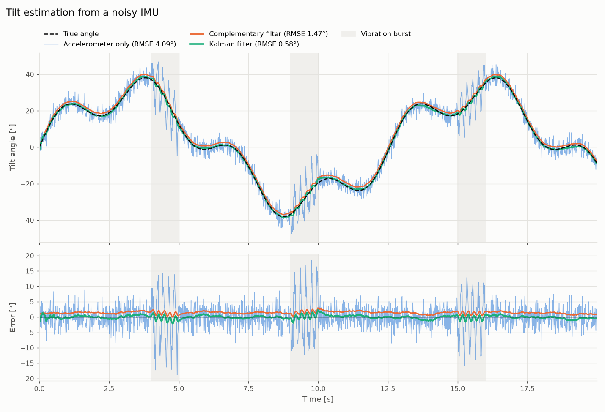

# kalman-imu-demo

Estimating the tilt angle of a simulated, noisy IMU (accelerometer + gyroscope)
with a **Kalman filter**, compared to a **complementary filter** and to the raw
accelerometer angle.



| Estimator            | RMSE (seed 42) |
|----------------------|---------------:|
| Accelerometer only   | 4.09°          |
| Complementary filter | 1.47°          |
| Kalman filter        | 0.58°          |

The Kalman filter also estimates the gyro bias: 2.71 °/s against a true 3.00 °/s.

## Quick start

Requires Python 3.9+.

```bash
python -m venv .venv
# Windows:      .venv\Scripts\activate
# Linux/macOS:  source .venv/bin/activate
pip install -r requirements.txt

python main.py          # prints RMSEs and writes docs/angle_comparison.png
pytest                  # runs the test suite
```

Options: `python main.py --alpha 0.95 --seed 1 --output out.png`.

## Project layout

```
kalman_imu/
  simulation.py   ground-truth motion + noisy gyro/accelerometer model
  filters.py      accel angle, ComplementaryFilter, KalmanFilter, helpers
  plotting.py     comparison figure
main.py           runs the whole demo
tests/            pytest tests
docs/             generated figure
```

## The math

### Sensor model

The sensor rotates about its y-axis by the angle $\theta(t)$. With $\omega = \dot\theta$:

* **Gyroscope**: $\omega_m = \omega + b + n_g$. It is accurate over short
  intervals, but the constant bias $b$ (3 °/s here) makes the integrated
  angle drift without bound ($b \cdot t$, i.e. 60° after 20 s).
* **Accelerometer**: it measures gravity projected on the body axes, plus any
  linear acceleration $d$ (vibration) and noise:

$$a_x = g\sin\theta + d + n_x, \qquad a_z = g\cos\theta + n_z$$

The accelerometer-only angle is

$$\theta_{acc} = \operatorname{atan2}(a_x,\ a_z)$$

It does not drift, but it is noisy, and it is badly wrong during vibration
because an accelerometer cannot tell gravity from motion. The shaded bands in
the plot show these vibration bursts.

The two sensors fail in complementary ways: the gyro is good at high
frequency, the accelerometer at low frequency. Both filters exploit this.

### Complementary filter

$$\hat\theta_k = \alpha\,(\hat\theta_{k-1} + \omega_{m,k}\,\Delta t) + (1-\alpha)\,\theta_{acc,k}$$

This is a high-pass filter on the integrated gyro plus a low-pass filter on
the accelerometer, with a shared time constant
$\tau = \alpha\Delta t / (1-\alpha)$ (0.49 s for $\alpha = 0.98$ at 100 Hz).

It is simple and cheap, but it does not model the gyro bias. With a
constant bias, its steady-state error is

$$e_{ss} = b\,\tau = 3\ ^\circ/\text{s} \times 0.49\ \text{s} \approx 1.47^\circ$$

That is the constant offset of the orange curve in the plot, and it matches
the measured RMSE.

### Kalman filter

The Kalman filter makes the bias part of the state, so it can estimate and
remove it:

$$x = \begin{bmatrix}\theta \\ b\end{bmatrix}, \qquad
x_k = \underbrace{\begin{bmatrix}1 & -\Delta t \\ 0 & 1\end{bmatrix}}_{F} x_{k-1}
    + \underbrace{\begin{bmatrix}\Delta t \\ 0\end{bmatrix}}_{B}\omega_{m,k} + w_k,
\qquad z_k = \underbrace{\begin{bmatrix}1 & 0\end{bmatrix}}_{H} x_k + v_k$$

Here the gyro is the control input, the accelerometer angle $z_k = \theta_{acc,k}$
is the measurement, and
$w \sim \mathcal N(0, Q)$ with $Q = \operatorname{diag}(q_\theta, q_b)\,\Delta t$,
$v \sim \mathcal N(0, R)$.

**Predict** (gyro):

$$\hat x^-_k = F\hat x_{k-1} + B\omega_{m,k}, \qquad P^-_k = F P_{k-1} F^\top + Q$$

**Update** (accelerometer):

$$y_k = z_k - H\hat x^-_k, \qquad S_k = H P^-_k H^\top + R, \qquad K_k = P^-_k H^\top S_k^{-1}$$

$$\hat x_k = \hat x^-_k + K_k y_k, \qquad P_k = (I - K_k H) P^-_k (I - K_k H)^\top + K_k R K_k^\top$$

The covariance update uses the Joseph form, which keeps $P$ symmetric and
positive-definite despite rounding errors.

Unlike the fixed $\alpha$, the gain $K_k$ comes from the modelled uncertainties.
Through the off-diagonal terms of $P$, every accelerometer correction also
refines the bias estimate. Once the bias is learned, the gyro integration is
nearly unbiased and the filter can rely on it more heavily. That is why
it beats the complementary filter here.

**Tuning** (defaults in `KalmanFilter`): `q_angle=0.001`, `q_bias=0.003`,
`r_measure=0.03`. A larger `r_measure` trusts the accelerometer less, which
gives better rejection of vibration but slower correction. A smaller `q_bias`
models a more constant bias.

## License

[MIT](LICENSE)
